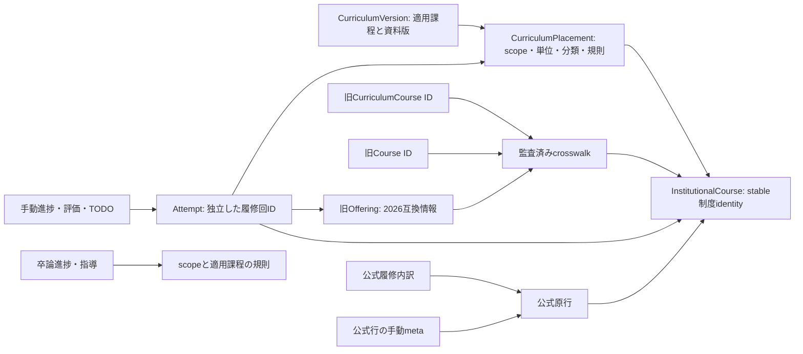

# 年度非依存化の詳細設計

設計日: 2026-10-11（Asia/Tokyo）。基準dev: `05dac8c7deb5f9abea93c9967237aacf0427863c`。状態: **参照方向・保護境界を決める目標設計。新しい型・保存モデルは未実装。** 本文の概念フィールド名は後続実装で確定する。[方針](planner-curriculum-release-policy.md)、[現状監査](planner-docs-current-audit-2026-10-11.md)、[移行計画](planner-year-independent-migration.md)と併読する。

## 現行コードと目標の対応

| 現行entity / 実装 | 現状の責務と制約 | 目標での責務 |
| --- | --- | --- |
| `CurriculumCourse` / `curriculumGeneration.ts` | 2026公式行群。名称・構成単位・Mapping/scope配列。singletonは`curriculum:<mappingId>`、explicit groupはledger ID。321 IDは永久同一性の証明ではない | 旧IDを互換参照としてpin。制度科目への明示crosswalkを設ける。年度開講がなくても正式科目を参照できる |
| `Course` / `plannerCatalog.ts` | 209 provisionalな旧計算identity。Offering.courseIdから参照される。課程の正本ではない | `LegacyCourse`相当の互換境界に閉じる。新stable科目型との同名混用を避ける |
| `Mapping` / `plannerHelpers.ts` | 学科・コースscope、分類、要件種別、構成単位、学年/方式制約、出典。Offering.mappingIds→Mapping、CurriculumCourse.mappingIds→Mapping | 適用課程内の配置を表す`CurriculumPlacement`の元資料。stable科目＋curriculumVersion＋scopeから配置を引く。年度固有履修条件を追加しない |
| `Offering` / `catalog.ts` | 2026開講、方式、単位、期、コード、Mapping edge。Curriculum関係はunique/候補/不明。ロード時に686件と全relation coverageを要求 | 旧2026開講・保存参照・年度照合根拠を解決する互換資料。新規計画の成立条件にしない。翌年Offeringを生成しない |
| `PlannerItem` / `plannerItemState.ts` | offeringId必須、同じIDの重複禁止。年度・状態・寄与・修得順を保存 | 独立`Attempt`。一つの科目に複数の履修回、同じ旧Offeringにも複数回を記録できる |
| 公式原行 / 内訳 / meta | `gradeImportApply.ts`の原行ID、内訳.sourceCourseId、meta[achievementId] | source identityと数量を継続保持。照合は別association、内訳は公式aggregateを再生成しない |

## 参照方向とマスターの版

目標は以下の方向で参照する。Offeringや履修年からマスター・適用課程を生成しない。

`InstitutionalCourse`はstable IDと名称定義の履歴・同一性証拠を持つ。正式名称の定義は教育課程表revisionに結びつける。`CurriculumPlacement`は`institutionalCourseId + curriculumVersionId + scopeId`に属する配置ID、構成単位、分類、算入規則への参照、制度上の方式制限と出典を持つ。同科目でも課程別単位や必修/選択が違えば別配置とする。改正が新科目・統合・分割なら同一identityのまま扱わず、証拠付きの関係を別途記録する。

科目・配置・規則は利用者stateへ重複保存せず版を参照する。ただし旧データの意味を再現する原版、定義のsnapshot、手動値の由来は互換archiveで保持する。現在の公式教育課程表が過去全記録の定義を証明するわけではない。確認済み版だけを登録し、未知課程の記録も保存可能、算入は必要な範囲で保留とする。

現`current_2026 / legacy_or_transition / unknown`は保持する。入学年・plannedYear・取り込み日で適用課程を決定しない。旧`current_2026`を将来の具体版へ引くには監査済み固定adapterが必要。selectedScopeIdの変更は記録の科目・手動分類・過去の適用根拠を書き換えない。

## 通信・スクーリング・単位の区別

同一制度科目へのrelationが証拠付きで確定している場合、通信・通常スクーリング・メディアは同科目の別履修回として扱う。名前・コード・単位一致だけで統合しない。メディアは現型のschooling＋deliveryCategoryに相当する利用者の方式情報として保持する。方式未確認も許容する。年度別に提供可能な方式をマスターへ列挙する機能は作らない。

| 数量 | owner / 表示 | 禁止する変換 |
| --- | --- | --- |
| 制度上の構成単位 | 課程別Placement。現CurriculumCourse/Mapping.curriculumCreditsが移行元 | 旧Offering.creditsから補完しない |
| 公式修得単位 | `ImportedCourseAchievement.earnedCreditsTotal` | 通信・スク内訳の和、手動寄与、最新マスターで置換しない |
| 公式スクーリング/構成/認定/追加履修 | 原行の各独立field | earnedへ加算、原行nullを0へ変換しない |
| 公式内訳単位 | ImportedStudyRecord.credits。parentとsource/年度/方式を保持 | aggregateと同時加算、複数Attemptへ自動配分しない |
| 手動履修回の寄与 | Attemptの明示値と由来。未設定と明示0を区別 | 公式数量や制度単位を修得量として自動コピーしない |
| 旧開講/登録単位 | 2026互換定義・過去根拠 | 翌年度の登録単位・履修可否に昇格しない |
| 卒業算入単位 | 適用課程・scopeの既存allocatorの結果 | CourseProgressの単純合計を渡さない |

例えば制度4単位の科目と旧スクーリング2単位は矛盾しない。通信4、通信寄与2＋スク2、別回スク2＋スク2の記録を区別する。これらは説明例であり、全科目に許可された履修方法や再履修規則ではない。completionは構成単位との進捗比較、卒業算入・年度上限・資格判定はそれぞれ既存の条件と根拠で評価する。

現`courseCreditContribution`未設定時のOffering.credits fallbackを失わせないため、移行時は旧値・「未設定」状態をそのまま残し、互換projectionのみに原版Openingの値を使う。新記録の単位不明はnull/未設定として表示し、参考マスター値と本人が確認した値を別にする。新モデルでこれを保存する具体fieldは未確定である。

## 独立履修回の最小契約

次は論理契約。既存v22の`PlannerItem`型をこの文書で変更しない。

| 論理field | 契約 |
| --- | --- |
| attemptId | 独立・不変ID。科目ID、Offering ID、年度、配列位置を主キーにしない |
| institutionalCourseRef / placementRef | 未照合ならnull＋候補・状態・元名称/旧参照。科目確定と課程配置確定は独立。exact参照は版と存在・整合性を検証 |
| legacyOfferingRef | 任意の旧ID＋原版revision。互換意味の保存。新規の2027計画では不要 |
| method context | 本人の希望/記録、公式内訳、旧2026参考を区別。unknownも許容。名称から補完しない |
| status | planned / in_progress / waiting / earned / failed / droppedを引き継ぐ。状態・最終評価・component合格は独立 |
| plannedYear / plannedTerm / studyYear | 既存意味のまま希望暦年・希望時期・履修学年。`plannedYear`を公式academicYearへ改名して移行しない |
| actual year context | source / inferred / manual / unknownと値・出典を一緒に保持。旧plannedYearから実績年度を生成しない |
| earnedOrder / contribution | 利用者が確認した順序と寄与。ID生成順、予定年、評価から補完しない |
| source association | 既存importedSourceCourseIdを保持。新しいcomponent↔attemptリンクは独立associationで、根拠・手動選択を保存。原行をattemptへ移動しない |
| membership | activeな計画行か、計画削除後に残るdetachedなownerかを区別。detachedから数量を生成しない |

2027以降も科目＋希望年度＋希望方式だけで計画・進捗を記録できる。実績の自己申告は手動記録であり、大学の履修資格・開講確定・公式修得量を意味しない。unknown identityの記録も元名称・手動内容を保持し、未照合欄に出す。

再履修・未完成科目の追加履修は別attemptIdを発行する。同一科目・同一年度・同一旧Offeringを保存禁止条件にしない。二重クリック等の同一操作再送はoperation/attempt IDで冪等に扱い、意図的な別履修回は明示追加とする。全科目共通の「構成単位以上なら再登録禁止」は導入しない。Media再履修制限に関する既存の利用者報告は公式PDF確認と区別し、正式な適用範囲が確定するまで自動禁止の根拠にしない。

## 進捗・評価・TODO・卒論のowner

| 現在の保存/操作 | 目標参照 | 移行・動作の条件 |
| --- | --- | --- |
| mediaSchoolingProgress[offeringId] / `mediaSchooling.ts` | progress[attemptId] | 回数・動画・テスト・assessment ID/名称/日付をそのまま移す。同科目の別回へ共有しない |
| correspondenceProgress[offeringId] / `correspondenceProgress.ts` | progress[attemptId] | requiredReportsのnull、レポート状態・番号・評価、examGrade保持。翌年度に2026リポート数を公式必要数として自動設定しない |
| courseEvaluations[offeringId] / `courseEvaluations.ts` | evaluations[attemptId] | final/report/schooling評価を独立保持。公式評価へ上書きしない |
| todos[].offeringId | 任意attemptRefまたは旧互換参照 | TODO ID・本文・doneを保持。ownerの対応不明なら未解決参照のまま。同科目の最新回へ自動付替えしない |
| removeUndo / 再追加 | 同じattemptId・配列位置・membershipを復元 | 削除後もprogress ownerをdetachedとして保持。新しい再履修回に古い進捗を自動適用しない。既存「再追加で復元」は明示復元操作として提供 |
| importedCourseUserMeta[achievementId] | 同じachievementId | 状態・予定年・期・studyYearを保持。公式sourceに混入しない |
| thesisProgressByScope / thesisGuidanceByScope | scopeを継続、将来は適用課程の規則を別参照 | 卒論をOffering/Attemptに変換しない。選択・状態・step ID・passedOn・geographyReportSubmitted保持。課程切替時の規則未対応でも消さない |
| publicCourses[id] | 既存独立IDを継続 | 2単位・手動名・評価・予定年を保持。同名マスターへ自動統合しない |

旧stateでitemなしの進捗・評価・TODO参照が残る場合は、旧Offeringごとに一つのdetached ownerを作って参照を保持する（件数はプレビューで別掲）。履修状態や修得量を捏造しない。未知Offeringの原文は正常移行成功にせず保護・個別対応に回す。新旧mapを同時に数量集計しない。

UI、CSV/PNG、Media共有、検索、分類、削除/Undo、import補完は同じowner resolverを使う。派生CourseView/CourseProgressを保存しない。`annualPlan.ts`の旧Opening参照によるthrowや`validation.ts`のmap/ID制約も更新対象であり、Pageだけの変更では完了しない。

## 公式原行と手動情報・算入境界

現行ImportedCourseAchievement/ImportedStudyRecordは取得contractの許可fieldを保存した原行・内訳であり、ポータルHTML全文を保存したものではない。今回「原本保持」と呼ぶ対象はその許可field、id/fingerprint/source、rawName/categoryRaw、数量、capturedAt、rawYear/rawTerm/日付・reports、照合選択・年度根拠を含む保存済み情報である。新しい不要な個人情報を取得しない。

原行の公式値と、利用者による年度・照合先選択・手動metaを由来込みで保持する。移行でrawを再抽出、fingerprintを再発行、source identityを新科目IDへ置換しない。capturedAtは取得日時であり、試験日・リポート日・履修年度ではない。#126の年度根拠保護を継承する。source↔attemptの一致を科目IDだけで決めず、複数年度・方式を含む原行を一つの履修回に潰さない。

学科別算入はstable identity→適用課程Placement→scope別Mapping/既存規則に進む。Mapping候補を先頭選択しない。共通科目、法律partial2、史学の同名別定義・修得順・反復上限、地理の段階再配分、認定・外国語・体育・公開科目・卒論の特殊経路を維持する。多対多の候補は記録保持と算入保留を分ける。

後続の移行で旧2026データを既存計算adapterへ渡す場合は、原版のlegacy Course/Offering/Mapping・順序・全fieldを使い、変更前と同じ結果を要求する。新しい開講なしAttemptを架空Offeringへ変換して計算することは採用しない。新規Attemptの算入consumerは別Issueで監査して導入し、未対応中は必要な軸をunknownとして表示する。既知公式aggregateを消す理由にはしない。official-priorityの重複抑制を弱めず、held公式量を手動入力で埋め戻さない。

## 未確定事項と推奨案

| 判断 | 選択肢・影響範囲 | 推奨 / 確定に必要なもの |
| --- | --- | --- |
| stable IDの実値 | 全ID再発行は全参照移行、旧321 IDの全採用は誤同一性固定、限定採用はcrosswalkが必要 | 証拠が揃うものだけ旧IDを採用可能とし、他は別namespaceへpin。発行規約・公式行照合を先に監査。実値一覧は未確定 |
| 改正時のsame/split/merge | 単位差をPlacement改訂にするか新科目にするかでcompletion/重複抑制が変わる | 大学の適用・読替根拠ごとに判断。名称・単位差だけで決定しない |
| Attemptの具体JSON形 | 旧items拡張か独立attempt collection。UI/Undo/map/decoderに影響 | 独立collection＋旧v22入力adapterを推奨。field名とclosed schemaは保存PR前に確定 |
| 新手動履修回の単位 | 課程構成単位を既定にするか、本人入力のnull許容とするかで参考合計に影響 | 本人入力と由来を独立保存、マスター値は参考。方式別確定単位がない時はunknown。制約・表示の具体契約は後続Issue |
| 希望暦年と履修年度のUI | plannedYearを意味変更するか、希望暦年/実績年度を並べるか | 旧意味を保持し別欄。4月境界の推定表示と手動年度を区別。新UI表記は未確定 |
| backup出力の次版 | v2内部の許可schema拡張かv3導入。旧clientの拒否/原版契約に影響 | 新モデルはv3を推奨。v1/v2 decoderを残す。最終envelopeはschema/参照PRで確定 |
| 卒論の改正後step対応 | 旧scopeのみかversion別か。指導記録・認定規則に影響 | scope原記録を保持、公式の改正対応表が得られるまで別課程へ自動転写しない |

上記の推奨は未確認事実の確定ではない。参照分離、旧ID/原文保護、数量authority、開講収録を不要とする境界は確定し、値・公式読替・新schemaの具体fieldは証拠と受け入れテストが揃ってから決める。
